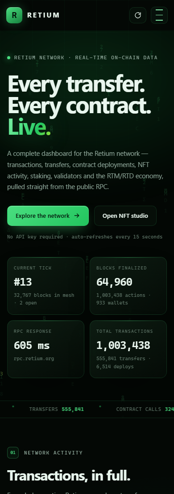

# Retium Live — Network Dashboard

A complete, real-time dashboard for the [Retium](https://retium.net) network. Every number on the page is pulled live from Retium's public APIs — no hardcoded chain stats, no API keys, no backend.


<p align="center">
  
</p>

## What it shows

- **Network activity** — total transactions, transfers, contract calls, contract deploys, stake/unstake operations, validator registry actions, safehouse operations, multisig actions and API-key operations, all broken down by share of the ledger.
- **Transaction volume** — histogram for 24 hours, 7 days or 30 days with in-range totals, per-bucket averages and the busiest bucket.
- **Network health** — keepers, suits, workers and RPC nodes online, plus active/new wallet counts over 24h, 7d and 30d.
- **Fee flow** — where every RTM of gas goes: collected, burned, workers, foundation, treasury, suits and keepers.
- **NFT studio** — tracks RCP NFT collections, indexes mint/transfer/burn events, renders collection supply, and looks up any wallet's NFT gallery. You can add any collection by contract id.
- **Staking** — stake vs. unstake volume, validator registry activity, node operators and net staking direction.
- **Economy** — RTD supply, reserves, customers and the safehouse (mint / redeem / lock) operations.
- **Explorer** — look up a transaction, block, wallet or contract id using the network's own lookup endpoint.
- **Live ledger** — streaming transaction feed with type filters, finalized block feed and block/transaction detail views.

## Data sources

All data is fetched client-side, directly from Retium's public endpoints. Both APIs send `Access-Control-Allow-Origin: *`, so the static site works from any origin, including GitHub Pages.

| Source | Used for |
| --- | --- |
| `https://rpc.retium.org/api/stats` | ledger totals, transaction type breakdown, blocks, wallet windows, fee flow |
| `https://rpc.retium.org/api/tick/current` | current tick and RPC latency |
| `https://rpc.retium.org/api/ticks/list` | recent tick history |
| `https://rpc.retium.org/api/transactions` | live transaction feed and filters |
| `https://rpc.retium.org/api/transactions/histogram` | transaction volume chart |
| `https://rpc.retium.org/api/mesh` | keeper / suit / worker / RPC node counts |
| `https://rpc.retium.org/api/wallet/{address}` | wallet balances, stake, rewards |
| `https://rpc.retium.org/api/wallet/{address}/tokens` | wallet token balances |
| `https://rpc.retium.org/api/wallet/{address}/nfts` | wallet NFT gallery |
| `https://rpc.retium.org/api/wallet/{address}/transactions` | wallet transaction history |
| `https://rpc.retium.org/api/wallet/{address}/rewards` | wallet staking rewards |
| `https://rpc.retium.org/api/transaction/{id}` | transaction detail |
| `https://rpc.retium.org/api/block/{id}` | block detail |
| `https://rpc.retium.org/api/contract/{id}` | contract detail |
| `https://rpc.retium.org/api/contract/{id}/events` | NFT mint / transfer / burn events |
| `https://rpc.retium.org/api/contract/{id}/query` | NFT `total_supply` |
| `https://rpc.retium.org/api/safehouse` | RTD mint / redeem / lock operations |
| `https://rpc.retium.org/api/lookup/{query}` | explorer auto-detection of ids |
| `https://api.retium.money/api/summary` | RTD supply, reserves and customers |

The RPC response time shown in the hero is measured in the browser, not reported by the API.

### About NFT totals

Retium's public API exposes NFT data **per wallet** and **per contract** — there is no global "all NFTs on the network" counter. To stay honest instead of inventing a number, the NFT studio:

1. Indexes a list of tracked RCP NFT contracts (one collection is seeded).
2. Queries each contract's `total_supply` and event log.
3. Sums mint, transfer and burn events across tracked contracts.

The UI labels this as **Nft supply indexed** / **across tracked contracts** so it is never mistaken for a network-wide total. Add more collections with the form in the NFT section to widen the index.

## Tech

- Plain HTML, CSS and JavaScript — no framework, no bundler, no build step.
- Single-page layout with hash navigation, reveal-on-scroll animations and a canvas rain effect that respects `prefers-reduced-motion`.
- Responsive from small phones to wide desktops.
- Uses `localStorage` only to remember your tracked collections and chart range. No cookies, no analytics, no tracking.

## Run locally

Because the site is fully static, any file server works. Opening `index.html` directly from disk usually fails (browsers block `fetch` from `file://`), so serve the folder:

```bash
# Python
python -m http.server 8000

# or Node
npx serve .
```

Then open <http://localhost:8000>.

## Deploy to GitHub Pages

A workflow is included at `.github/workflows/deploy.yml`. It publishes the repository root on every push to `main`.

1. Create a repository on GitHub.
2. Push this folder:

   ```bash
   git init
   git add .
   git commit -m "Retium Live dashboard"
   git branch -M main
   git remote add origin https://github.com/<your-user>/<your-repo>.git
   git push -u origin main
   ```

3. On GitHub, open **Settings → Pages** and set **Source** to **GitHub Actions** (the workflow uses `configure-pages` / `deploy-pages`, so no branch selection is needed).
4. The site deploys to `https://<your-user>.github.io/<your-repo>/`.

The `.nojekyll` file is included so GitHub Pages serves the static assets as-is.

## Project structure

```
.
├── index.html               # page structure and section copy
├── assets/
│   ├── styles.css           # design system, layout, responsive rules, animations
│   ├── app.js               # API layer, renderers, NFT indexer, explorer, retries
│   └── favicon.svg
├── docs/
│   ├── preview.png          # desktop preview used in this README
│   └── mobile.png           # mobile preview
├── .github/workflows/
│   └── deploy.yml           # GitHub Pages deployment
├── .nojekyll
├── LICENSE
└── README.md
```

## Customization

- **Seed another NFT collection** — edit `DEFAULT_COLLECTION` in `assets/app.js`. You can also add collections at runtime in the NFT section; they persist in `localStorage` (`retium-live.collections.v1`).
- **Refresh cadence** — see `startTimers()` in `assets/app.js`: core stats every 15s, feeds every 10s, NFT index every 60s.
- **Endpoint or network changes** — `API` and `MONEY` constants sit at the top of `assets/app.js`.
- **Look and feel** — colors, spacing and typography are CSS custom properties in `:root` in `assets/styles.css`.

## Notes

- This is an independent, community-built dashboard. It is not an official Retium product.
- The Retium API is occasionally rate-limited or briefly unavailable. The UI degrades gracefully, keeps the last good data, shows retry buttons and backs off automatically.
- Figures such as wallet counts are derived from the API's rolling wallet windows when a top-level total is not published; the UI labels them accordingly.

## License

[MIT](LICENSE)
