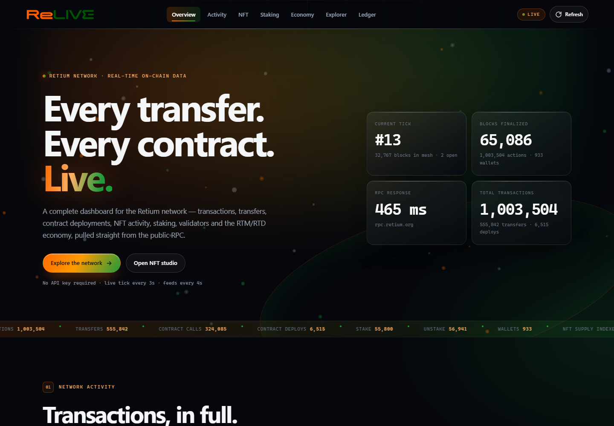

# RELIVE — Retium Network Dashboard

A real-time, brand-forward dashboard for the [Retium](https://retium.net) network. Every number, feed and NFT artwork is pulled live from Retium's public APIs — no hardcoded chain stats, no API keys, no backend.



<p align="center">
  
</p>

## Live, by default

- **Tick + RPC latency** refresh every **3 seconds**.
- **Transaction and block feeds** refresh every **4 seconds**, with new rows highlighted as they land.
- **Aggregate panels** (stats, staking, economy, fees) refresh every **10 seconds**.
- **NFT index** refreshes every **60 seconds**; metadata and artwork are cached per token.
- The footer shows the exact time of the last sync and how many seconds ago it happened.
- Pauses automatically while the tab is hidden; catches up when you return.

## What it shows

- **Network activity** — total transactions, transfers, contract calls, contract deploys, stake/unstake operations, validator registry actions, safehouse operations, multisig actions and API-key operations, with each type's share of the ledger.
- **Transaction volume** — histogram for 24 hours, 7 days or 30 days, with in-range totals, per-bucket averages and the busiest bucket.
- **Network health** — keepers, suits, workers and RPC nodes online, plus active/new wallet counts over 24h, 7d and 30d.
- **Fee flow** — collected, burned, workers, foundation, treasury, suits and keepers.
- **NFT studio** — tracked RCP collections with **cover artwork**, per-token metadata, mint/transfer/burn events with thumbnails, wallet gallery with full artwork, and a collection tracker. Artwork is resolved through IPFS metadata and rendered as optimized thumbnails.
- **Staking** — stake vs. unstake volume, validator registry activity, node operators and net staking direction.
- **Economy** — RTD supply, reserves, customers and safehouse mint/redeem/lock operations.
- **Explorer** — transactions, blocks, wallets and contracts through the network's lookup endpoint.
- **Live ledger** — streaming transaction feed with type filters and a finalized block feed.

## Data sources

All data is fetched client-side from Retium's public endpoints (both send `Access-Control-Allow-Origin: *`).

| Source | Used for |
| --- | --- |
| `https://rpc.retium.org/api/stats` | ledger totals, transaction types, blocks, wallet windows, fee flow |
| `https://rpc.retium.org/api/tick/current` | current tick, blocks in mesh, RPC latency |
| `https://rpc.retium.org/api/ticks/list` | recent tick history |
| `https://rpc.retium.org/api/transactions` | live transaction feed and filters |
| `https://rpc.retium.org/api/transactions/histogram` | transaction volume chart |
| `https://rpc.retium.org/api/mesh` | keeper / suit / worker / RPC node counts |
| `https://rpc.retium.org/api/wallet/{address}` | wallet balances, stake, rewards |
| `https://rpc.retium.org/api/wallet/{address}/tokens` | wallet token balances |
| `https://rpc.retium.org/api/wallet/{address}/nfts` | wallet NFT gallery |
| `https://rpc.retium.org/api/wallet/{address}/transactions` | wallet transaction history |
| `https://rpc.retium.org/api/wallet/{address}/rewards` | wallet staking rewards |
| `https://rpc.retium.org/api/transaction/{id}` | transaction detail |
| `https://rpc.retium.org/api/block/{id}` | block detail |
| `https://rpc.retium.org/api/contract/{id}` | contract detail |
| `https://rpc.retium.org/api/contract/{id}/events` | NFT mint / transfer / burn events |
| `https://rpc.retium.org/api/contract/{id}/query` | NFT `total_supply` and `token_uri` metadata |
| `https://rpc.retium.org/api/safehouse` | RTD mint / redeem / lock operations |
| `https://rpc.retium.org/api/lookup/{query}` | explorer auto-detection |
| `https://api.retium.money/api/summary` | RTD supply, reserves and customers |

NFT artwork: `token_uri` points to IPFS metadata (name, image, attributes). The site fetches that metadata through public IPFS gateways and loads images via an image-optimization proxy, with direct-gateway fallbacks. Metadata is cached in `localStorage` (`retium-live.nftmeta.v1`, 7-day TTL).

## NFT totals — honest caveat

Retium's public API exposes NFTs **per wallet** and **per contract**; there is no global network NFT counter. Instead of inventing a number, RELIVE indexes a list of tracked RCP contracts (two are seeded), sums their `total_supply`, and counts their on-chain events. The UI labels this as **across tracked contracts**. Add more collections with the form in the NFT section to widen the index.

## Tech

- Plain HTML, CSS and JavaScript — no framework, no bundler, no build step.
- Orange/green web3 visual system with a live particle-mesh hero, glass panels and gradient data accents.
- Responsive from small phones to wide desktops; honors `prefers-reduced-motion`.
- `localStorage` is used only for tracked collections, chart range and NFT metadata cache. No cookies, no analytics, no tracking.

## Run locally

Serve the folder with any static server (opening `index.html` from disk blocks `fetch`):

```bash
python -m http.server 8000
# or
npx serve .
```

Then open <http://localhost:8000>.

## Deploy to GitHub Pages

`.github/workflows/deploy.yml` publishes the repository root on every push to `main`.

```bash
git init
git add .
git commit -m "RELIVE dashboard"
git branch -M main
git remote add origin https://github.com/<your-user>/<your-repo>.git
git push -u origin main
```

Then on GitHub: **Settings → Pages → Source: GitHub Actions**. The site appears at `https://<your-user>.github.io/<your-repo>/`. `.nojekyll` is included.

## Project structure

```
.
├── index.html               # page structure and copy
├── assets/
│   ├── styles.css           # visual system, layout, responsive rules
│   ├── app.js               # API layer, renderers, NFT indexer, art hydration
│   ├── relive-logo.png      # transparent wordmark used in header/footer
│   └── favicon.svg
├── docs/                    # README previews
├── .github/workflows/
│   └── deploy.yml
├── .nojekyll
├── LICENSE
└── README.md
```

## Customization

- **Seed collections / names** — edit `DEFAULT_COLLECTION`, `SECOND_COLLECTION` and `DEFAULT_NAMES` in `assets/app.js`.
- **Refresh cadence** — `startTimers()`: tick 3s, feeds 4s, core 10s, NFT 60s.
- **Endpoints** — `API`, `MONEY` and `IPFS_GATEWAYS` constants at the top of `assets/app.js`.
- **Look and feel** — color tokens in `:root`, then the RELIVE identity layer at the bottom of `assets/styles.css`.

## Notes

- Independent, community-built dashboard; not an official Retium product.
- The Retium API is occasionally rate-limited. Panels keep the last good data, show retry buttons, and back off automatically.
- Wallet counts are derived from the API's rolling wallet windows when no top-level total is published.

## License

[MIT](LICENSE)
